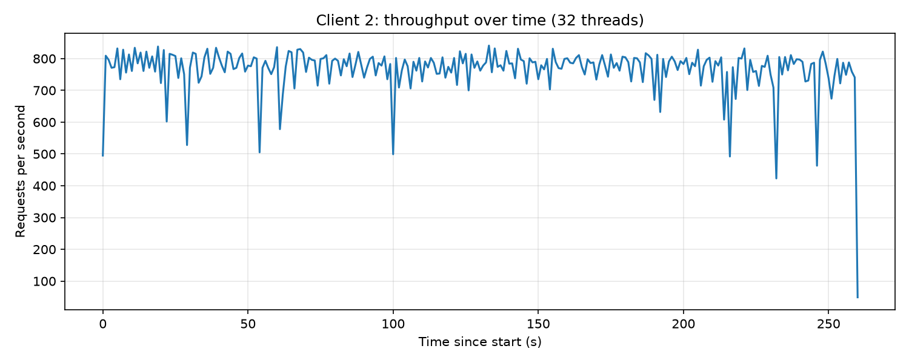

# sds-load-tester

A Java client that fires 200,000 requests at a small web service on AWS and measures how fast it answers.

The service is a minimal Spring Boot app on ECS Fargate that accepts a product and replies `201 Created`. The client sends from many threads at once and reports throughput, latency percentiles, and how close the result is to linear scaling.

<p align="center">
  
</p>

## The big picture

```
                      queue (1,000)            32 sender threads
generator thread  ──►  [ product, ... ]  ──►   POST /api/product  ──►  server on AWS ECS
 (makes 200,000                                 (retry up to 5×)        (returns 201)
  random products)
```

- **Generator**: one thread creates random products and puts them in a queue. When the queue is full, it waits.
- **Senders**: N threads (32 by default). Each one takes a product from the queue, sends it, and takes the next. When the generator is done, it puts a "stop" marker in the queue for every sender.
- **Server**: just receives the product and answers `201`, so the test measures the network and the threads, not business logic.

## Results

| Test | Throughput | Note |
|---|---|---|
| 1 thread, 10,000 requests | ~24.6 req/s | ~40 ms per request, mostly the network round trip |
| 32 threads, 200,000 requests | ~768 req/s | linear would be 32 × 24.6 ≈ 787, so almost linear |

The plot above is the 32-thread run: requests started in each second, steady around 750–800.

## Three clients

Each one builds on the previous one.

| Folder | What it does |
|---|---|
| `client-single/` | One thread, 10,000 requests one after another. Measures how long a single request takes. |
| `client1/` | Generator + N senders, 200,000 requests. Prints throughput and the "linear" expectation. |
| `client2/` | Same as client 1, but also records every request. Writes `latencies.csv` and prints mean, median, p99, min and max latency. |

## Requirements

- **Java 17+**. Maven isn't needed: every Java folder has its own `mvnw`.
- **Docker, AWS CLI, Terraform** to deploy the server, plus an AWS account
- **Python with matplotlib** for the plot

## Run

### 1. Start the server

Locally:

```powershell
cd server
.\mvnw spring-boot:run
```

Or on AWS. First connect the AWS CLI to your account (once) and check it works:

```powershell
aws configure
aws sts get-caller-identity
```

Then create the image repository, push the image, and create everything else:

```powershell
$registry = "$(aws sts get-caller-identity --query Account --output text).dkr.ecr.us-west-2.amazonaws.com"

cd terraform
terraform init
terraform apply -target="aws_ecr_repository.app_repo"

cd ..\server
docker build -t product-service .
aws ecr get-login-password --region us-west-2 | docker login --username AWS --password-stdin $registry
docker tag product-service:latest "$registry/product-service:latest"
docker push "$registry/product-service:latest"

cd ..\terraform
terraform apply
```

Terraform uses `LabRole`, the role that AWS Learner Lab provides. In a normal account that role doesn't exist, so in `terraform/ecs.tf` replace it with your own role that has the `AmazonECSTaskExecutionRolePolicy`.

Get the server's IP from the AWS console: ECS → Clusters → `product-service-cluster` → Tasks → the running task → Public IP.

Check it answers (expect `201`):

```powershell
Invoke-WebRequest -Method Post -Uri http://<server-ip>:8080/api/product -ContentType "application/json" -Body '{"product_id":42,"sku":"K7Q2M9X1BZ","manufacturer":"Acme Tools","category_id":812,"weight":2350,"some_other_id":9001}'
```

### 2. Run a client

The first argument is the server address. For client 1 and 2, the second is the number of sender threads.

```powershell
cd client-single
.\mvnw compile exec:java "-Dexec.args=http://<server-ip>:8080"
```

```powershell
cd client2
.\mvnw compile exec:java "-Dexec.args=http://<server-ip>:8080 32"
```

### 3. Draw the plot

```powershell
cd plot
pip install matplotlib
python plot.py ..\client2\latencies.csv
```

This saves `throughput.png`.

## AWS housekeeping

A running server costs money (Fargate Spot, 0.25 vCPU, about a cent an hour), and ending a Learner Lab session doesn't stop it. Pause it when you're not testing:

```powershell
aws ecs update-service --cluster product-service-cluster --service product-service --desired-count 0 --region us-west-2
```

Start it again with `--desired-count 1`. A new task gets a new IP, so look it up again in the console.

Delete everything (image repository, cluster, service, security group, logs):

```powershell
cd terraform
terraform destroy
```

## Code

```
server/          Spring Boot service, POST /api/product, Dockerfile
terraform/       ECR repository + ECS Fargate service in us-west-2 (0.25 vCPU, 512 MB)
client-single/   SingleThreadClient
client1/         MultiThreadClient, ProductProducer (generator), PostWorker (sender)
client2/         same as client1 + LatencyRecord and CSV/statistics
plot/            plot.py and the saved throughput.png
```
